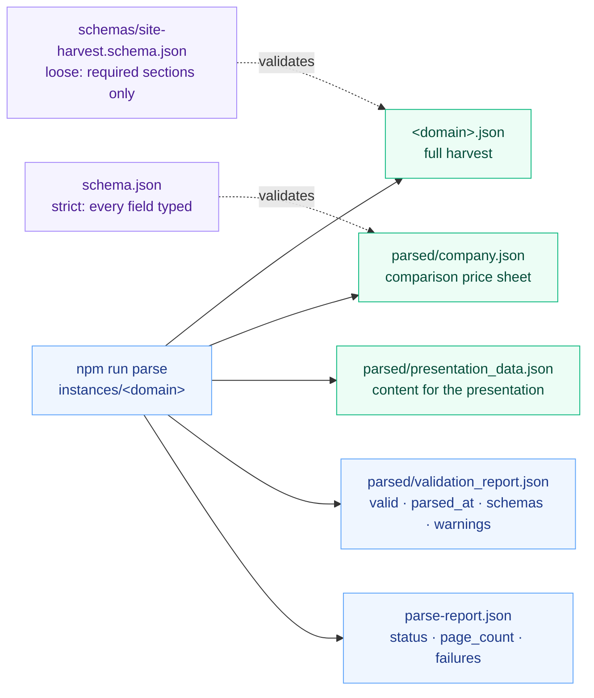
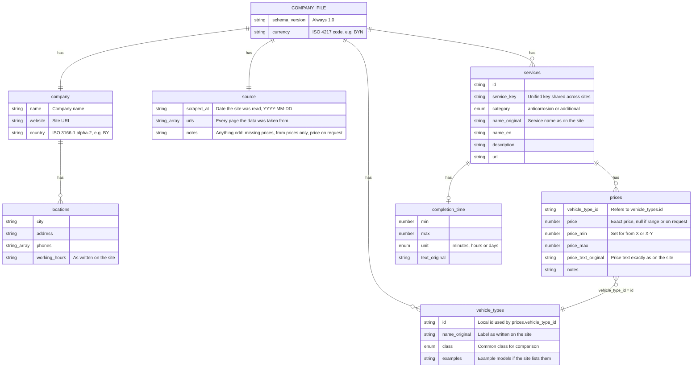
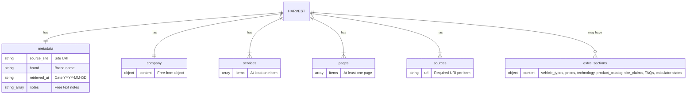

# JSON schemes with field descriptions

Every site produces several JSON files. Two of them are validated against a JSON Schema; the rest are reports. This page shows how the files relate, then describes each field of both schemas.

Field descriptions come from the schema files themselves: [`schema.json`](../schema.json) (company price sheet) and [`schemas/site-harvest.schema.json`](../schemas/site-harvest.schema.json) (full harvest). A `*` marks a required field; everything else is optional. The shorter, field-name-only diagram of the price sheet is in [schema-diagram.md](schema-diagram.md).

## 1. Files per site and who validates them

| File                            | Purpose                                                                                        | Validated by               |
| ------------------------------- | ---------------------------------------------------------------------------------------------- | -------------------------- |
| `<domain>.json`                 | Everything extracted from the site: company, services, pages, sources, plus evidence sections. | `site-harvest.schema.json` |
| `parsed/company.json`           | Normalised price sheet used for comparing companies.                                           | `schema.json`              |
| `parsed/presentation_data.json` | The same content reorganised for the presentation, with source metadata.                       | not schema-validated       |
| `parsed/validation_report.json` | Result of the validation and the extraction warnings.                                          | —                          |
| `parse-report.json`             | Run outcome: pages fetched, failures, status.                                                  | —                          |

The parser validates the harvest against `site-harvest.schema.json` and the comparison sheet against `schema.json` (`packages/harvest-core/src/index.js`); the validation report lists both schema paths in `schemas`.

## 2. Company price sheet — `schema.json`

One file per company: `parsed/company.json`. All data comes from the company's public website. No unknown fields are allowed (`additionalProperties: false` at every level).

### Root

| Field             | Type    | Description                                                                                                                        |
| ----------------- | ------- | ---------------------------------------------------------------------------------------------------------------------------------- |
| `schema_version`* | `"1.0"` | Constant; the version of this contract.                                                                                            |
| `company`*        | object  | Who the company is. See below.                                                                                                     |
| `source`*         | object  | Where and when the data was read.                                                                                                  |
| `currency`*       | string  | ISO 4217 code of every amount in the file, e.g. `BYN`.                                                                             |
| `vehicle_types`*  | array   | The car categories exactly as this company defines them, each mapped to a common class so companies can be compared. May be empty. |
| `services`*       | array   | Everything the company offers, with prices per vehicle type. May be empty.                                                         |

### `company`

| Field       | Type         | Description                    |
| ----------- | ------------ | ------------------------------ |
| `name`*     | string       | Company name.                  |
| `website`*  | string (URI) | Company site.                  |
| `country`   | string       | ISO 3166-1 alpha-2, e.g. `BY`. |
| `locations` | array        | Service points.                |

### `company.locations[]`

All fields optional.

| Field           | Type     | Description                |
| --------------- | -------- | -------------------------- |
| `city`          | string   | City of the service point. |
| `address`       | string   | Street address.            |
| `phones`        | string[] | Phone numbers.             |
| `working_hours` | string   | As written on the site.    |

### `source`

| Field         | Type           | Description                                                                              |
| ------------- | -------------- | ---------------------------------------------------------------------------------------- |
| `scraped_at`* | string (date)  | Date the site was read, `YYYY-MM-DD`.                                                    |
| `urls`*       | string[] (URI) | Every page the data was taken from.                                                      |
| `notes`       | string         | Anything odd about this site: missing prices, "from" prices only, price on request, etc. |

### `vehicle_types[]`

| Field            | Type   | Description                                                                                                                                     |
| ---------------- | ------ | ----------------------------------------------------------------------------------------------------------------------------------------------- |
| `id`*            | string | Local id, referenced by `prices[].vehicle_type_id`.                                                                                             |
| `name_original`* | string | Label as written on the site.                                                                                                                   |
| `class`*         | enum   | Normalised class: `small`, `sedan`, `crossover`, `suv`, `minivan`, `van`, `pickup`, `truck`, `any`, `other`.`any` means one price for all cars. |
| `examples`       | string | Example models if the site lists them.                                                                                                          |

### `services[]`

| Field             | Type             | Description                                                                                                                                                                                 |
| ----------------- | ---------------- | ------------------------------------------------------------------------------------------------------------------------------------------------------------------------------------------- |
| `id`*             | string           | Local service id, unique within the file.                                                                                                                                                   |
| `service_key`     | string           | Unified service key from `packages/harvest-core/src/services.js`, shared by every site offering the same service; `<domain>:<id>` when no other site offers it. Added by the shared runner. |
| `category`*       | enum             | `anticorrosion` = any rust-protection treatment; `additional` = everything else offered.                                                                                                    |
| `name_original`*  | string           | Service name as written on the site.                                                                                                                                                        |
| `name_en`         | string           | English name.                                                                                                                                                                               |
| `description`     | string           | Service description.                                                                                                                                                                        |
| `url`             | string (URI)     | Page of the service.                                                                                                                                                                        |
| `completion_time` | object or `null` | `null` if the site does not say.                                                                                                                                                            |
| `prices`*         | array            | Price entries per vehicle type. An empty array means no price was captured — not that the service is free.                                                                                  |

### `services[].completion_time`

All fields optional; a missing bound stays unknown.

| Field           | Type   | Description                   |
| --------------- | ------ | ----------------------------- |
| `min`           | number | Lower bound.                  |
| `max`           | number | Upper bound.                  |
| `unit`          | enum   | `minutes`, `hours` or `days`. |
| `text_original` | string | Duration text as on the site. |

### `services[].prices[]`

| Field                  | Type             | Description                                                                         |
| ---------------------- | ---------------- | ----------------------------------------------------------------------------------- |
| `vehicle_type_id`*     | string           | Refers to `vehicle_types[].id`. The JSON schema cannot check this; the parser does. |
| `price_text_original`* | string           | Price text exactly as on the site, e.g. `от 250 руб.`.                              |
| `price`                | number or `null` | Exact price; `null` if only a range or "on request".                                |
| `price_min`            | number or `null` | Set for "from X" or "X–Y".                                                          |
| `price_max`            | number or `null` | Upper end of a range.                                                               |
| `notes`                | string           | Qualifiers, units, scope.                                                           |

How wording maps to the numeric fields:

| Website wording        | `price` | `price_min` | `price_max` |
| ---------------------- | ------: | ----------: | ----------: |
| `250 BYN`              |     250 |        null |        null |
| `от 250 BYN`           |    null |         250 |        null |
| `250–400 BYN`          |    null |         250 |         400 |
| `по запросу` (if kept) |    null |        null |        null |

## 3. Full harvest — `schemas/site-harvest.schema.json`

The file `<domain>.json`. The schema is deliberately loose: it fixes only the required sections and leaves the evidence sections free-form, so each site can keep whatever the page offers.

| Field                    | Type          | Description                                                                                                                       |
| ------------------------ | ------------- | --------------------------------------------------------------------------------------------------------------------------------- |
| `metadata`*              | object        | Identifies the harvest.                                                                                                           |
| `metadata.source_site`*  | string (URI)  | The site that was read.                                                                                                           |
| `metadata.brand`*        | string        | Brand name.                                                                                                                       |
| `metadata.retrieved_at`* | string (date) | Retrieval date.                                                                                                                   |
| `metadata.notes`         | string[]      | Free-text notes.                                                                                                                  |
| `company`*               | object        | Company block; content not constrained by the schema.                                                                             |
| `services`*              | array (min 1) | Services as the parser extracted them.                                                                                            |
| `pages`*                 | array (min 1) | Fetched pages. In practice each has `url`, `title`, `description`, `headings`, `text`, `paragraphs`, `links`, `tables`, `images`. |
| `sources`*               | array (min 1) | Every source page; each item requires a `url` (in practice also `fetched_at`, `used_for`).                                        |

Extra sections observed in real harvests (for example `krown.by.json`) are allowed because the schema does not forbid additional properties:

| Section           | What it holds                                                                                                                                  |
| ----------------- | ---------------------------------------------------------------------------------------------------------------------------------------------- |
| `vehicle_types`   | Vehicle categories, same shape as in the price sheet.                                                                                          |
| `prices`          | Source URL and raw price tables.                                                                                                               |
| `technology`      | Materials and technology descriptions with source URLs.                                                                                        |
| `product_catalog` | Products listed on the site.                                                                                                                   |
| `site_claims`     | Statements and guarantees made by the site, each with its source URL and a verification note. They are claims by the site, not verified facts. |

## 4. Reports

### `parsed/validation_report.json`

| Field       | Description                                                                |
| ----------- | -------------------------------------------------------------------------- |
| `valid`     | `true` when the dataset passed all schemas and the ID checks.              |
| `parsed_at` | Timestamp of the run.                                                      |
| `schemas`   | Schema files used, e.g. `schemas/site-harvest.schema.json`, `schema.json`. |
| `warnings`  | Extraction warnings, often copied from `source.notes`.                     |

### `parse-report.json`

| Field                       | Description                                               |
| --------------------------- | --------------------------------------------------------- |
| `site`                      | Domain parsed.                                            |
| `status`                    | `complete`, `partial` or `failed`.                        |
| `published`                 | Whether the dataset was written to the site folder.       |
| `started_at`, `finished_at` | Run timestamps.                                           |
| `page_count`                | Pages fetched successfully.                               |
| `failures`                  | Pages that failed, with URL and error such as `HTTP 403`. |
| `snapshots`                 | Folder with the fetched page evidence.                    |
| `warnings`                  | Extraction warnings.                                      |

### `parsed/presentation_data.json`

| Field                | Description                                                                      |
| -------------------- | -------------------------------------------------------------------------------- |
| `schema_version`     | Version of the file.                                                             |
| `source`             | Site, brand, retrieval date and source URLs.                                     |
| `metadata`           | Copy of the harvest metadata.                                                    |
| `sources`            | Sources with `fetched_at` and `used_for`.                                        |
| `content`            | Company, services, vehicle types, prices, technology, catalog, claims and pages. |
| `section_index`      | Index of the sections in `content`.                                              |
| `claims_and_caveats` | Site claims and notes to show next to the data.                                  |
