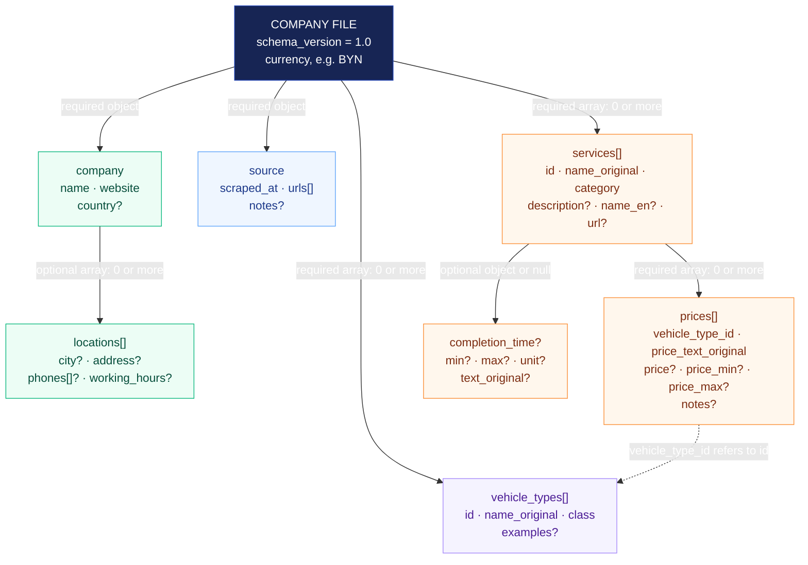

# Company JSON data model

This diagram describes the root `schema.json` contract. Each `instances/<domain>/parsed/company.json` is one company file. Solid arrows show nested data; the dashed arrow shows an ID reference within the same file. `?` means optional.

A price connects **one service** to **one vehicle category**. For example, a price with `vehicle_type_id: "sedan"` belongs to the vehicle record whose `id` is `"sedan"`. All amounts in that company file use its top-level `currency`.

## Reading the fields

- `name_original` keeps the site's own service or vehicle label. `class` maps a vehicle label to a common comparison category: `small`, `sedan`, `crossover`, `suv`, `minivan`, `van`, `pickup`, `truck`, `any`, or `other`.
- Service `category` is `anticorrosion` or `additional`.
- `prices: []` means no price entries were captured for that service. It does not mean the service is free. Vehicle types and services may also be empty arrays under this schema.
- Price amounts are optional and can also be `null`. `price_text_original` preserves qualifiers, units, and quote-only wording.
- Completion time is optional and can be `null`. Its unit is `minutes`, `hours`, or `days`; a missing bound stays unknown.
- Every field shown without `?` is required within its own object. Every location field and every completion-time field is optional. The root also requires all four branches shown in the diagram.
- The JSON schema validates structure and allowed values. Parser/application checks validate the dashed ID reference and ID uniqueness.

These fictional examples illustrate price representation:

| Website wording | `price` | `price_min` | `price_max` |
| --- | ---: | ---: | ---: |
| `250 BYN` | 250 | null | null |
| `от 250 BYN` | null | 250 | null |
| `250–400 BYN` | null | 250 | 400 |
| `по запросу` (if an entry is retained) | null | null | null |

## Full harvest versus comparison data

The diagram above covers the strict comparison record in `parsed/company.json`. The separate `schemas/site-harvest.schema.json` describes the broader harvest in `<domain>.json`: it requires `metadata`, `company`, `services`, `pages`, and `sources`. Its metadata identifies the source site, brand, and retrieval date; its page and source arrays must be nonempty. It permits extra evidence sections such as materials, technology, FAQs, calculator states, and site claims.
