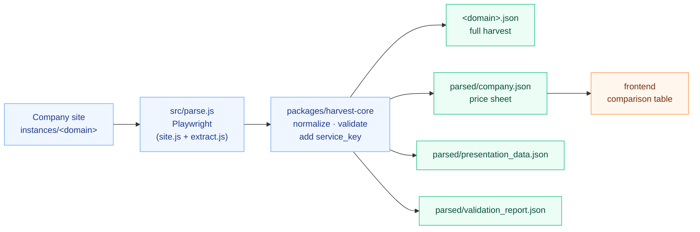
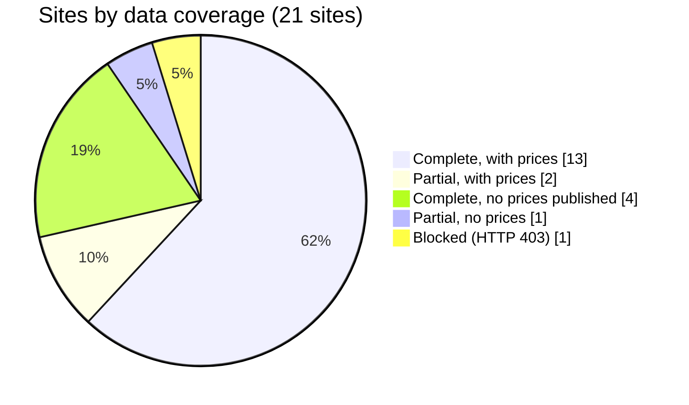
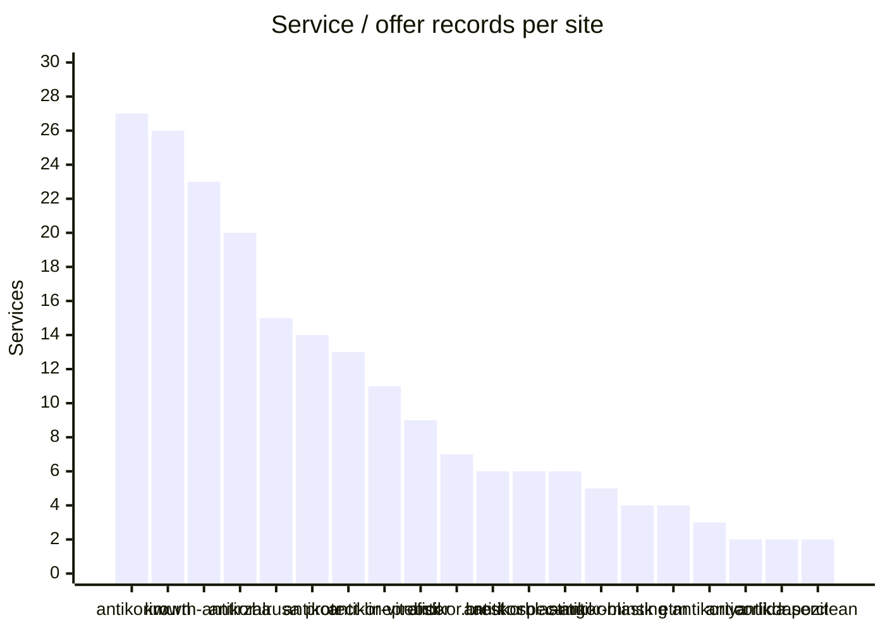
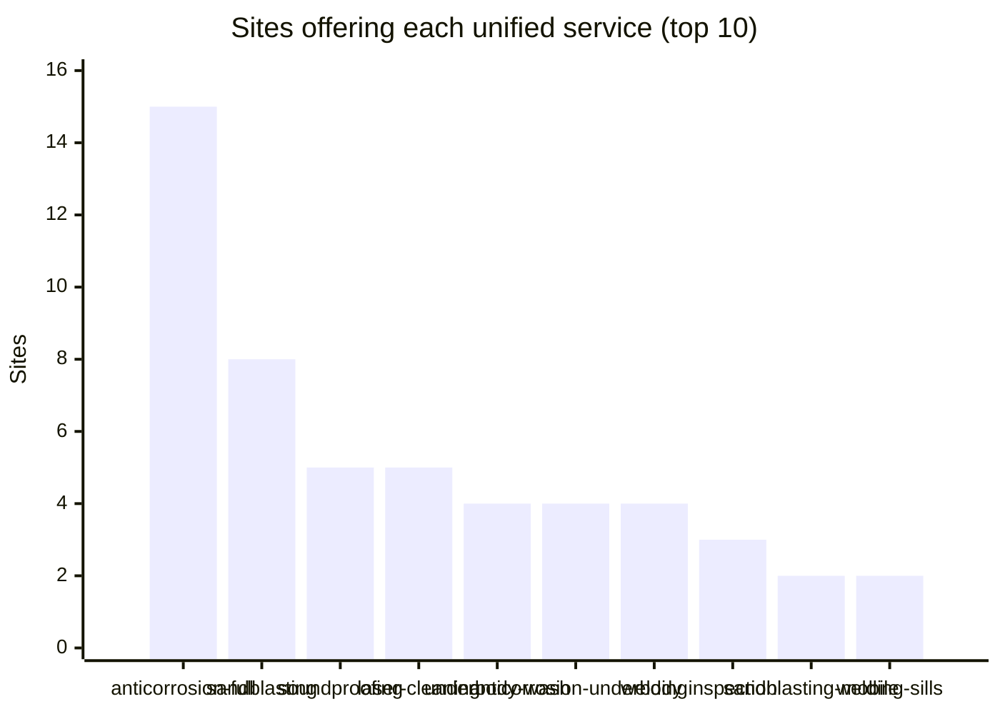
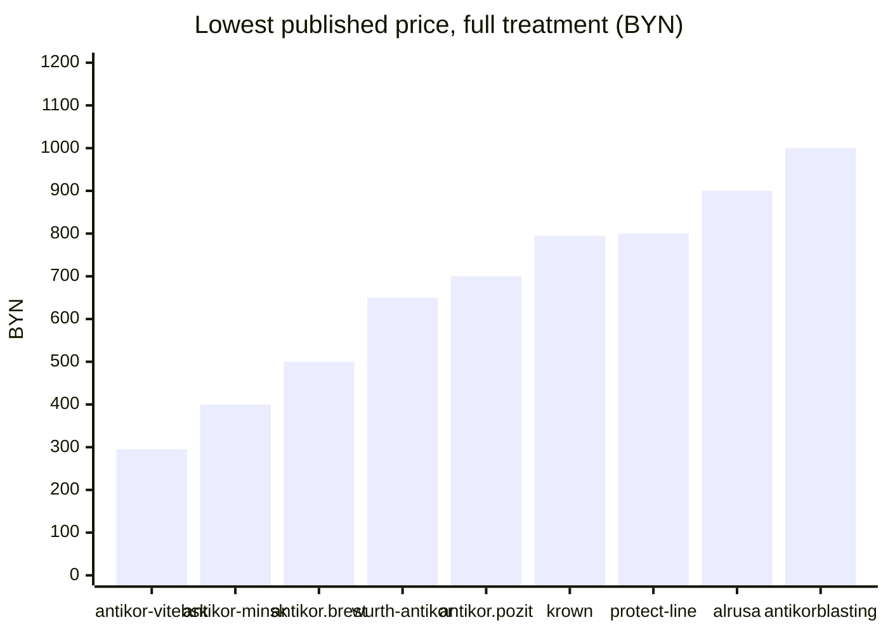
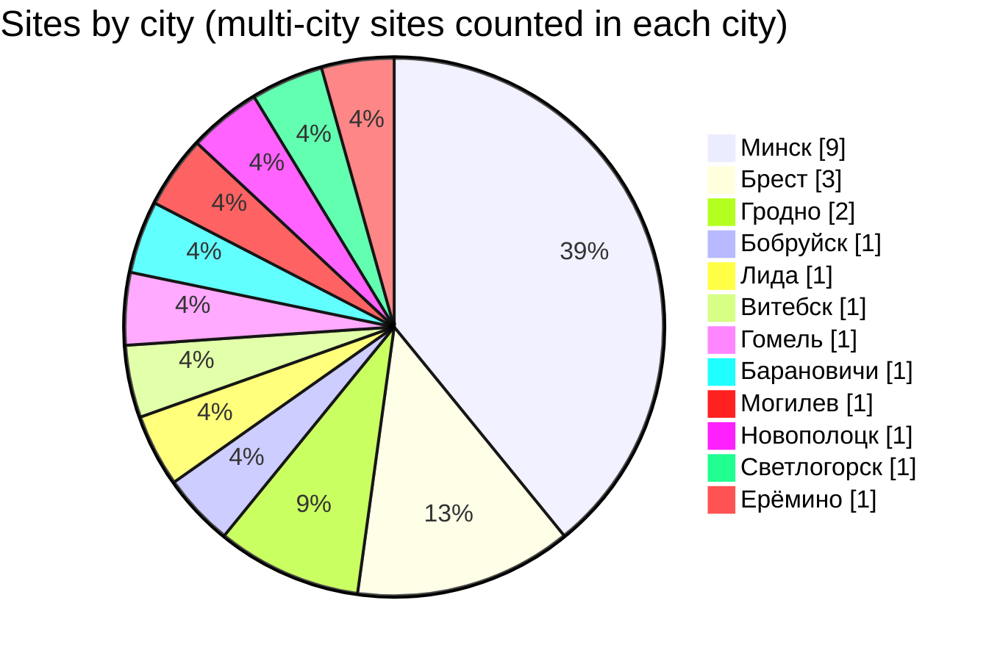

# Parsed sites summary — anticorrosion market, Belarus

Data as of **2026-10-26** (all runs share this scrape date). Source: `instances/*/parsed/company.json` and `instances/*/parse-report.json`, aggregated directly from the files — nothing is filled in from older JSON.

The earlier batch report, [harvest-2026-10-26.md](harvest-2026-10-26.md), covers the first 16 customers; this summary covers all 21 configured sites.

## At a glance

| Metric                                  |                                    Value |
| --------------------------------------- | ---------------------------------------: |
| Sites configured                        |                                       21 |
| Datasets published                      |              20 (17 complete, 3 partial) |
| Blocked, no dataset                     |                          1 (dinitrol.by) |
| Pages read                              |                                      229 |
| Service / offer records                 |                                      205 |
| Price entries                           | 3,410 (120 exact, 3,290 "from" or range) |
| Sites with at least one price           |                                 15 of 20 |
| Company locations                       |                                       25 |
| Unified service keys used by 2+ sites   |           22 (of 56 catalog keys in use) |
| Services only one site offers (own key) |                                       90 |
| Currency                                |                        BYN on every site |

> Antikor-Minsk alone contributes 3,060 of the price entries (its calculator lists every brand/model). Compare site coverage by the _Services_ and _Vehicle types_ columns rather than raw price counts.

## How the data was produced



The `company.json` structure is described in [docs/schema-diagram.md](../docs/schema-diagram.md).

## Coverage status



- **Complete, with prices (13):** alrusa.by, antikor-minsk.by, antikor-vitebsk.by, antikor.brest.by, antikor.pozit.by, antikorblasting.by, antikorim.by, antikoriya.by, antikorr.by, antirzha.by, krown.by, protect-line.by, wurth-antikor.by.
- **Partial, with prices (2):** proficor.by, spec-antikor.by.
- **Complete, no prices published (4):** anti-kor.by, anticorlida.by, etm.by, laserclean.by. An empty price list means the amount is missing, not that the service is free.
- **Partial, no prices (1):** blasting.by.
- **Blocked (1):** dinitrol.by — HTTP 403 on every access path.

## Services offered per site



## Which services are comparable across sites

Sites name the same service differently, so every service gets a unified `service_key` (rules in `packages/harvest-core/src/services.js`). Keys offered by 2+ sites:



| Service key               | Sites | Which                                                                                                                                                                                 |
| ------------------------- | ----: | ------------------------------------------------------------------------------------------------------------------------------------------------------------------------------------- |
| `anticorrosion-full`      |    15 | alrusa, anti-kor, anticorlida, antikor-minsk, antikor-vitebsk, antikor.brest, antikor.pozit, antikorblasting, antikorr, blasting, etm, krown, laserclean, protect-line, wurth-antikor |
| `sandblasting`            |     8 | alrusa, anti-kor, antikor-vitebsk, antikorim, antirzha, blasting, protect-line, spec-antikor                                                                                          |
| `soundproofing`           |     5 | anti-kor, antikorim, antirzha, etm, spec-antikor                                                                                                                                      |
| `laser-cleaning`          |     5 | antikorim, antirzha, laserclean, spec-antikor, wurth-antikor                                                                                                                          |
| `underbody-wash`          |     4 | anti-kor, antikorr, antirzha, krown                                                                                                                                                   |
| `anticorrosion-underbody` |     4 | antikor.brest, antikorr, krown, protect-line                                                                                                                                          |
| `welding`                 |     4 | antikor.brest, antirzha, blasting, protect-line                                                                                                                                       |
| `inspection`              |     3 | anticorlida, antikor-minsk, antikor-vitebsk                                                                                                                                           |
| `sandblasting-mobile`     |     2 | alrusa, antirzha                                                                                                                                                                      |
| `welding-sills`           |     2 | alrusa, antikorim                                                                                                                                                                     |
| `welding-arches`          |     2 | alrusa, antikorim                                                                                                                                                                     |
| `welding-underbody`       |     2 | alrusa, antikorim                                                                                                                                                                     |
| `welding-patch`           |     2 | alrusa, antikorim                                                                                                                                                                     |
| `body-painting`           |     2 | antikor-vitebsk, antirzha                                                                                                                                                             |
| `anticorrosion-cavities`  |     2 | antikor.brest, protect-line                                                                                                                                                           |
| `protective-film`         |     2 | antikor.brest, antikorim                                                                                                                                                              |
| `headlight-polishing`     |     2 | antikor.brest, proficor                                                                                                                                                               |
| `sandblasting-frames`     |     2 | antikorim, antirzha                                                                                                                                                                   |
| `vin-cleaning`            |     2 | antikorim, antirzha                                                                                                                                                                   |
| `anticorrosion-sills`     |     2 | antikorr, protect-line                                                                                                                                                                |
| `anticorrosion-arches`    |     2 | antikorr, protect-line                                                                                                                                                                |
| `anticorrosion-ev`        |     2 | antirzha, proficor                                                                                                                                                                    |

90 further services appear on one site only (e.g. Krown's wash and cleaning extras, Antikorr's DINITROL/NOXUDOL complexes) and keep their own `<domain>:<id>` key.

## Price snapshot: full anticorrosion treatment

Lowest published price for the whole-car treatment (`anticorrosion-full`), across that site's vehicle classes. These are entry-level figures only — vehicle scopes, units and "from" wording differ between sites, so treat this as orientation, not a ranking.



| Site               | Lowest | Highest |
| ------------------ | -----: | ------: |
| antikor-vitebsk.by |    295 |     395 |
| antikor-minsk.by   |    400 |   1,150 |
| antikor.brest.by   |    500 |     990 |
| wurth-antikor.by   |    650 |   1,150 |
| antikor.pozit.by   |    700 |     900 |
| krown.by           |    795 |   1,300 |
| protect-line.by    |    800 |     800 |
| alrusa.by          |    900 |   1,950 |
| antikorblasting.by |  1,000 |   1,000 |

Offer full treatment but publish no price for it: anti-kor.by, anticorlida.by, antikorr.by, blasting.by, etm.by, laserclean.by.

## Geography



Minsk dominates (9 sites, including the `etm.by` network). Brest has 3 (`antikor.brest.by`, `spec-antikor.by`, an `etm.by` branch), Grodno 2, every other city one. `etm.by` is the only multi-city network (Minsk, Novopolotsk, Brest, Svetlogorsk).

## Per-site table

| Site                                                            | Company                                 | City                                  | Status             | Pages | Services | Vehicle types | Price entries | Price kind       |
| --------------------------------------------------------------- | --------------------------------------- | ------------------------------------- | ------------------ | ----: | -------: | ------------: | ------------: | ---------------- |
| [alrusa.by](../instances/alrusa.by/README.md)                   | ООО "СТО Алруса"                        | Гродно                                | complete           |     7 |       15 |            10 |            15 | mixed (8 exact)  |
| [anti-kor.by](../instances/anti-kor.by/README.md)               | ANTICOR                                 | Бобруйск                              | complete           |     1 |        6 |             0 |             0 | none             |
| [anticorlida.by](../instances/anticorlida.by/README.md)         | ИП Бунжа О.Я.                           | Лида                                  | complete           |     1 |        2 |             0 |             0 | none             |
| [antikor-minsk.by](../instances/antikor-minsk.by/README.md)     | ANTIKOR-MINSK                           | Минск                                 | complete           |     1 |        5 |         1,020 |         3,060 | from / range     |
| [antikor-vitebsk.by](../instances/antikor-vitebsk.by/README.md) | Antikor-Vitebsk                         | Витебск                               | complete           |     1 |       11 |             3 |             3 | from / range     |
| [antikor.brest.by](../instances/antikor.brest.by/README.md)     | Артглас                                 | Брест                                 | complete           |    23 |        7 |             7 |            14 | exact            |
| [antikor.pozit.by](../instances/antikor.pozit.by/README.md)     | ООО «Позит»                             | Минск                                 | complete           |     1 |        2 |             1 |             4 | from / range     |
| [antikorblasting.by](../instances/antikorblasting.by/README.md) | ООО "Антикор Бластинг Кампани"          | Минск                                 | complete           |     3 |        6 |             1 |             1 | from / range     |
| [antikorim.by](../instances/antikorim.by/README.md)             | ООО «АвтоПрофКузов»                     | Минск                                 | complete           |    12 |       27 |             6 |            35 | mixed (4 exact)  |
| [antikoriya.by](../instances/antikoriya.by/README.md)           | Антикория                               | Гомель                                | complete           |     1 |        3 |             5 |            15 | from / range     |
| [antikorr.by](../instances/antikorr.by/README.md)               | ООО «Антикор-Центр»                     | Минск                                 | complete           |    13 |       14 |             8 |            52 | mixed (10 exact) |
| [antirzha.by](../instances/antirzha.by/README.md)               | Частное унитарное предприятие «Першы а… | Барановичи                            | complete           |    55 |       20 |             4 |            13 | from / range     |
| [blasting.by](../instances/blasting.by/README.md)               | Blasting.by                             | Могилев                               | partial            |     1 |        4 |             0 |             0 | none             |
| [dinitrol.by](../instances/dinitrol.by/README.md)               | —                                       | —                                     | blocked (HTTP 403) |     0 |        0 |             0 |             0 | —                |
| [etm.by](../instances/etm.by/README.md)                         | Евротехмаркет                           | Минск, Новополоцк, Брест, Светлогорск | complete           |    61 |        4 |             0 |             0 | none             |
| [krown.by](../instances/krown.by/README.md)                     | KROWN                                   | Минск                                 | complete           |    21 |       26 |            24 |           131 | mixed (78 exact) |
| [laserclean.by](../instances/laserclean.by/README.md)           | Laserclean                              | Гродно                                | complete           |     1 |        2 |             0 |             0 | none             |
| [proficor.by](../instances/proficor.by/README.md)               | PROFICOR                                | Минск                                 | partial            |     5 |        9 |             5 |            12 | mixed (1 exact)  |
| [protect-line.by](../instances/protect-line.by/README.md)       | PROTECT-LINE                            | Ерёмино                               | complete           |    12 |       13 |             1 |            10 | from / range     |
| [spec-antikor.by](../instances/spec-antikor.by/README.md)       | Спец Антикор                            | Брест                                 | partial            |     1 |        6 |             6 |            36 | from / range     |
| [wurth-antikor.by](../instances/wurth-antikor.by/README.md)     | Центр антикоррозийной обработки премиа… | Минск                                 | complete           |     8 |       23 |             7 |             9 | mixed (5 exact)  |

## Per-site notes

- **alrusa.by** — Two dated price schedules saved; the one valid on the scrape date is used. Sandblasting prices differ between the home page and `/peskostrui/`. Underbody, premium/commercial, chassis repair and welding have no numeric prices.
- **anti-kor.by** — Single page, no tariffs published.
- **anticorlida.by** — Single page, no tariffs published.
- **antikor-minsk.by** — Online calculator: 1,020 brand/model entries × 3 services, every price is "from".
- **antikor-vitebsk.by** — Three "from" prices (sedan / crossover / SUV); most of the 11 services have no price.
- **antikor.brest.by** — Exact prices per vehicle class, 23 pages read.
- **antikor.pozit.by** — Two "from" prices for the complex treatment.
- **antikorblasting.by** — One range ("от 1000 до 3500"), no vehicle breakdown.
- **antikorim.by** — Largest service list (27). Starting prices are approximate, final price after inspection. "Cross" and "Minibus" merge several body types.
- **antikoriya.by** — Two locations in Gomel, 15 "from" prices for 3 services.
- **antikorr.by** — Prices are approximate. DINITROL / NOXUDOL complexes 1–4 are separate services; per-area pages carry no prices.
- **antirzha.by** — 55 pages read. Package prices are all "from"; sandblasting is priced per m², not per car.
- **blasting.by** — Partial: `/contact/` returns HTTP 200 with a not-found page (soft 404). No prices.
- **dinitrol.by** — Blocked: HTTP 403 for every access path. No dataset published, nothing guessed.
- **etm.by** — 61 pages, 4 locations. No numeric prices on the public service pages — quote on request.
- **krown.by** — Most granular price sheet: 24 vehicle types, 131 prices (78 exact). Mostly wash / cleaning extras.
- **laserclean.by** — Single page, no tariffs published.
- **proficor.by** — Partial: `/mojka/` and `/shumoizolyacziya/` return empty HTTP 301.
- **protect-line.by** — 12 pages, 10 anticorrosion services (body areas separately); "from" prices.
- **spec-antikor.by** — Partial: six linked pages return HTTP 404. Home page and every calculator state were published.
- **wurth-antikor.by** — Premium German/Swedish materials; 23 services, vehicle-class price list.

## Caveats for comparison

- **Units differ.** Most prices are per car, but some sandblasting rates (e.g. antirzha) are per m², and some "from" prices are for packages with different contents.
- **Vehicle categories are the sites' own.** They are mapped to a common `class` (small, sedan, crossover, suv, minivan, van, …), but a site's "Cross" or "Minibus" may merge several body types; the original labels are kept in `name_original`.
- **Prices are mostly indicative.** Several sites (e.g. antikorim, antikorr, antirzha) state that the final price is set after inspection.
- **Missing ≠ free.** `prices: []` only means no amount was captured.
- **Claims are the sites' own** (guarantees, material origin) and are kept attributed to their source URLs.

## Refreshing

```sh
pnpm parse                        # all sites
cd instances/<domain> && npm run parse   # one site
pnpm services:keys                # re-key datasets after editing the service catalog
```
